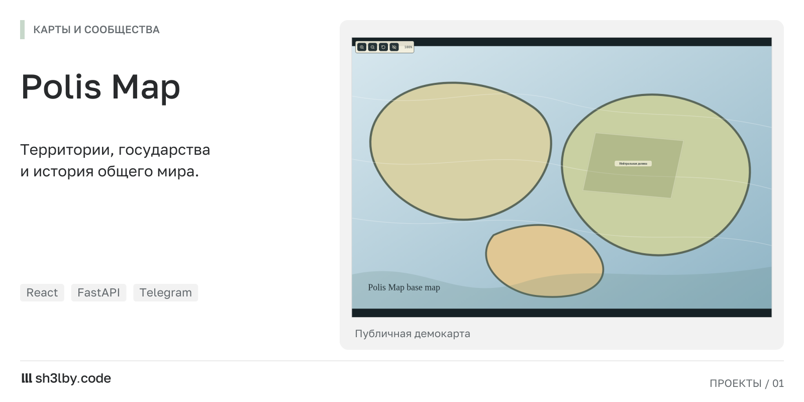

# Polis Map

<!-- portfolio-card:start -->
[](docs/portfolio/screenshot.png)

Скриншот работающего веб-демо Polis Map. [Полный размер](docs/portfolio/screenshot.png).
<!-- portfolio-card:end -->

Карта ролевого мира, которую можно менять вместе с событиями игры. Игроки видят территории государств и подают заявки на колонизацию. Модератор принимает решение, редактирует границы и сохраняет историю изменений.

Polis Map решает задачу сообщества, которому нужна общая актуальная карта с понятными правилами редактирования. Публичная карта доступна для просмотра, а управление вынесено в отдельную панель.

## От заявки до новой границы

- Игрок связывает профиль с Telegram через одноразовый код и отправляет заявку.
- Модератор в `/admin` одобряет или отклоняет действие, создаёт государства и рисует полигоны поверх карты.
- Журнал сохраняет изменения. Текущую карту можно выгрузить в PNG для публикации в сообществе.
- Необязательный бот даёт доступ к `/link <code>`, `/profile`, `/map` и `/actions`.

В проекте можно оценить связку React-интерфейса, API с игровыми правилами и привязки Telegram-аккаунта. Базовое изображение карты загружается через панель; поверх него отображаются территории, столицы и спорные зоны.

[Открыть демокарту](https://polis.demo.patewen.space). Обсудить похожий проект: [sh3l.beer](https://sh3l.beer).

## Стек

| Слой | Технологии |
|---|---|
| API | Python 3.12, FastAPI, SQLAlchemy 2, Pydantic Settings, Pillow (PNG export) |
| Web | React 18, TypeScript, Vite |
| Bot | aiogram 3 |
| Хранение | SQLite (файл в `data/`), базовые карты в `assets/maps/` |
| Проверки | pytest, тесты API |

## Запуск

API и собранный frontend работают в одном контейнере:

```bash
cp .env.example .env        # change ADMIN_PASSWORD
docker compose up -d --build
# http://127.0.0.1:8000  (public map)  ·  /admin  ·  /docs
```

Для подключения бота задайте `TELEGRAM_BOT_TOKEN` в `.env` и выполните `docker compose --profile bot up -d`.

Локальная разработка:

```bash
make setup      # venv + npm install
make dev-api    # :8000
make dev-web    # :5173, proxies /api to the backend
make test
```

Данные администратора по умолчанию: `admin` / `admin`. Перед публикацией замените их через `ADMIN_USERNAME` / `ADMIN_PASSWORD`.

## Структура проекта

```
backend/app/   main.py (routes), services.py (domain logic), models.py, security.py
frontend/src/  App.tsx (public map + admin panel), api.ts, types.ts
bot/           aiogram handlers
assets/maps/   base maps (sample-world.svg is generated on first start)
tests/         API tests
```

## Лицензия

MIT
